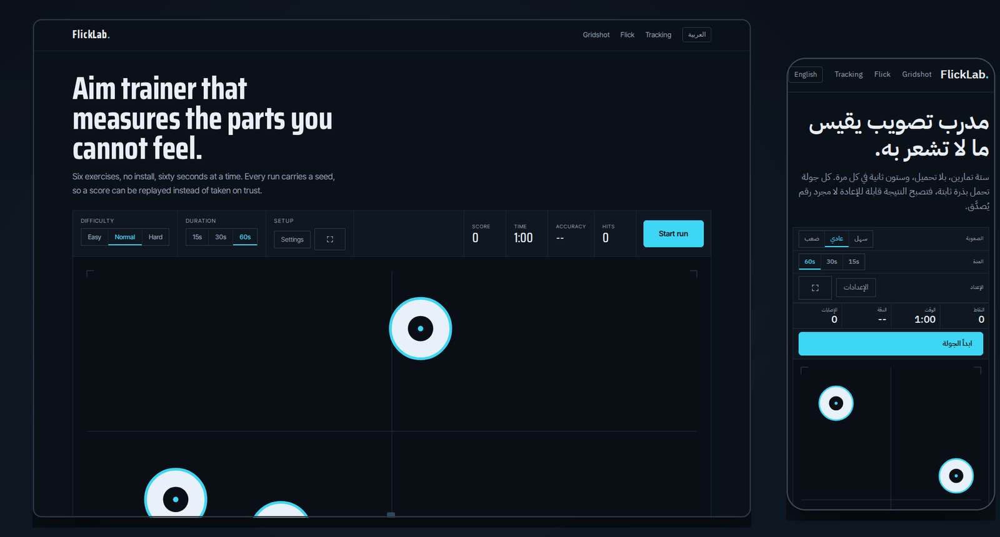
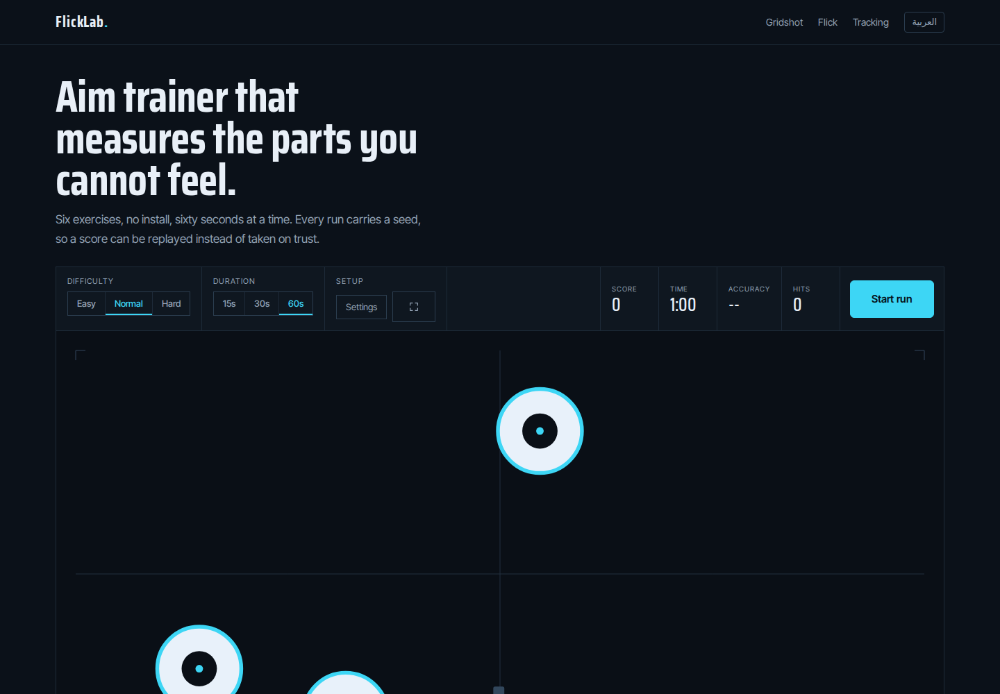
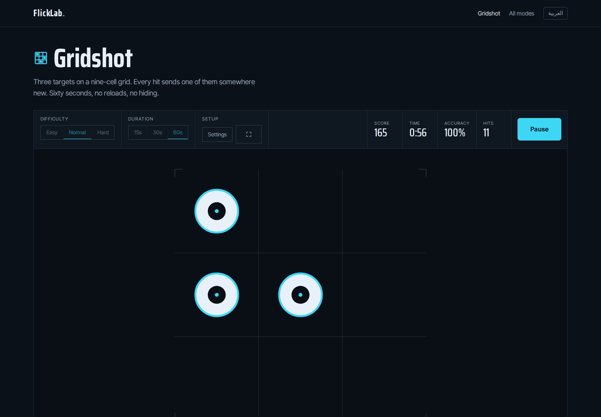
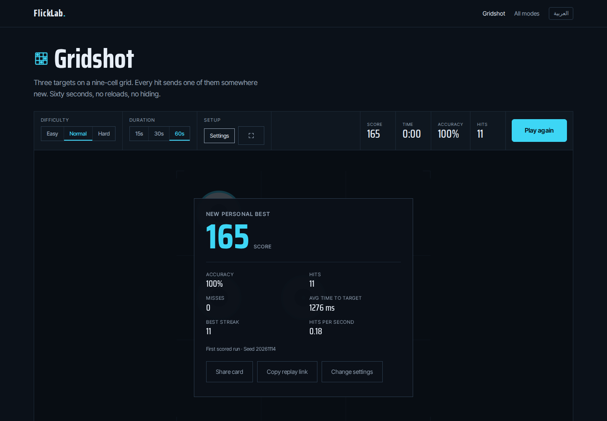
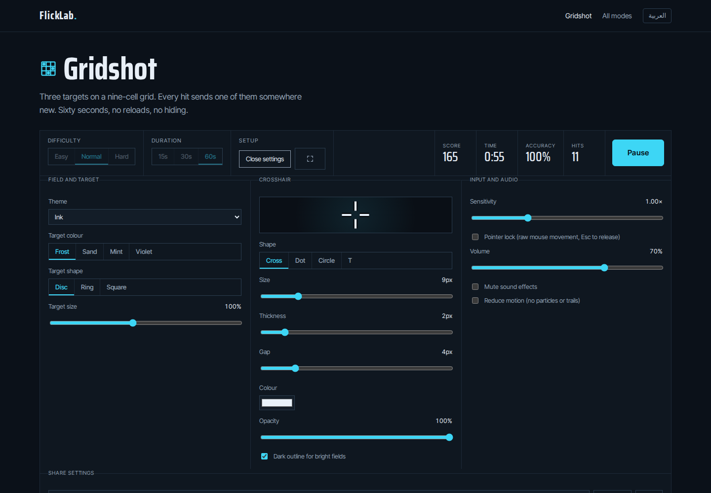
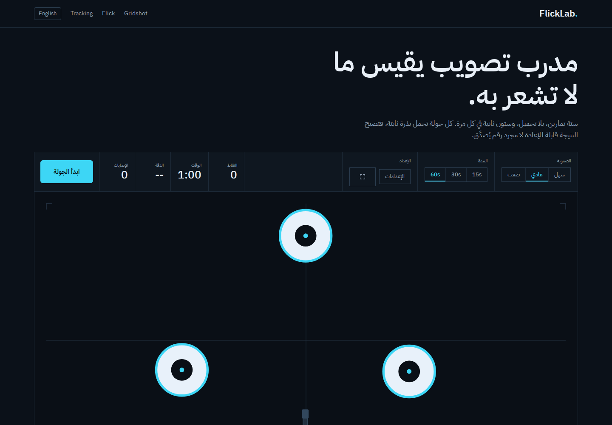
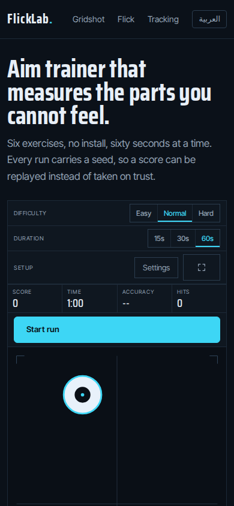

<div align="center">

# FlickLab

**A browser aim trainer that treats a score as a claim you can replay.**

Six exercises on one deterministic engine. No install, no account, no ads — and every run carries the seed that produced it, so a result can be checked instead of trusted.

[](https://flicklab.vercel.app)
[](LICENSE)
[](#testing)
[](#stack)
[](#internationalisation)

[**Play now**](https://flicklab.vercel.app/en/) · [النسخة العربية](https://flicklab.vercel.app/ar/) · [How the engine works](#how-the-engine-works) · [Deploy it yourself](#deployment)



</div>

---

## Why another aim trainer

Most browser aim trainers ask you to trust a number. FlickLab is built the other way round: the simulation is a pure function of `(seed, config, ordered input log)`, so the same seed reproduces the same target layout, the same spawn order and the same score on any device. A run can be replayed, exported and compared without a server vouching for it.

Everything else follows from that constraint:

- **One engine, six modes.** Targets, hit detection, the clock and the RNG are shared; a mode only decides where targets appear and how a run is scored.
- **Static by default.** Fourteen pre-rendered pages (seven routes × two locales) with copy, metadata and JSON-LD in the HTML. JavaScript mounts the game only after you press play.
- **Local-first.** Scores, personal bests and settings live in `localStorage`. There is no backend, so there is nothing to leak.

## Features

| | |
| --- | --- |
| **Six modes** | Gridshot, Flick, Tracking, Precision, Reaction time and CPS, each with its own scoring model and three difficulty levels |
| **Verifiable runs** | Seeded target layout, fixed-timestep simulation, replayable input log and a `?seed=` link that reproduces the run |
| **Share cards** | A finished run exports a 1200×630 PNG (Web Share sheet on mobile, download elsewhere) with score, accuracy and the replay link |
| **Deep settings** | Three themes, a colourblind-safe palette, target shape/scale/colour, a configurable crosshair, sensitivity, pointer lock, volume and reduced motion |
| **Share codes** | `FL1.` codes carry a whole settings object through the same sanitiser as stored data, so a hand-edited code cannot put an out-of-range value into a run |
| **Bilingual** | English and Arabic as first-class locales: mirrored layouts, translated HUD, results and share cards — not a swapped stylesheet |
| **Phone-ready** | A stacked rail, four-cell HUD, ≥40 px touch targets and a fullscreen fallback for browsers without element fullscreen |
| **Accessibility** | Logical CSS properties for mirroring, focus-managed results, `prefers-reduced-motion`, keyboard start/restart and labelled controls |

## Screenshots

| Home (EN) | Gridshot run |
| --- | --- |
|  |  |

| Results | Settings |
| --- | --- |
|  |  |

| Home (AR, RTL) | Phone |
| --- | --- |
|  |  |

## Modes

| Mode | Input | Score | What it measures |
| --- | --- | --- | --- |
| **Gridshot** | three live targets on a nine-cell grid | hits × difficulty × 10 | target acquisition under time pressure |
| **Flick** | one target, guaranteed jump after a hit | hits × difficulty × 10 | long-distance corrections |
| **Tracking** | cursor position sampled at 240 Hz | on-target % × difficulty × 10 | sustained cursor control |
| **Precision** | shrinking target, a miss restores size | hits × difficulty × 10 | accuracy without a speed bonus |
| **Reaction** | five trials, seeded delay | round(100 000 / avg ms) × difficulty | time from stimulus to click |
| **CPS** | clicks inside a fixed pad | clicks per second × 100 × difficulty | sustained click rate |

Difficulty is `1` / `1.5` / `2` for Easy / Normal / Hard. Every mode reads the same `Appearance` record (theme, target colour, shape, scale), so changing a setting re-skins the live field without restarting the run.

## Quick start

```bash
git clone https://github.com/Aetherdz/flicklab.git
cd flicklab
pnpm install
pnpm dev            # http://localhost:5173 — host exposed for tunnels
```

Requires Node 20+ and pnpm 9+ (the lockfile is pnpm).

```bash
pnpm build          # regenerate pages, typecheck, bundle into dist/
pnpm preview        # serve the production build
pnpm test           # unit tests (Vitest)
pnpm test:e2e       # browser tests (Playwright)
pnpm pages          # regenerate en/<mode>/ and ar/<mode>/ from content/
pnpm fonts          # re-download the self-hosted woff2 subsets
pnpm shots          # refresh docs/screenshots (needs the dev server on :4173)
```

## How the engine works

The simulation is a pure function of `(seed, config, ordered input log)`.

- **Fixed timestep.** `Loop` advances the simulation in quanta of `1000/240` ms and renders once per frame with an interpolation factor. Frame pacing cannot change what happens inside a run.
- **Stepped clock.** `Game` owns the run clock as a step counter. Taps arrive through a queue and are applied at the next step with timestamps relative to run start, so replaying a log reproduces the same result exactly.
- **Seeded RNG.** `Rng` is xoshiro128\*\* with a four-word state. Every random decision (spawn cell, angle, speed) draws from one stream in a fixed order.
- **Mode runtime.** Modes implement `begin`, `update`, `tap`, `draw` and `result`. They receive a mutable `World` in CSS pixels and re-derive positions from normalised coordinates, so a resize never mutates the stored run.
- **Allocation-free frames.** Targets and hit particles come from fixed-size pools; nothing in `update` or `draw` allocates.
- **Honest reaction time.** Reaction uses `event.timeStamp` from the input event, not a render frame. Canvas coordinates are CSS pixels; the backing store is scaled by `devicePixelRatio`, capped at 2 on touch devices.

Hit feedback is a fixed-size spark and ring pool, skipped entirely when reduced motion is on.

## Stack

| Layer | Choice |
| --- | --- |
| Build | Vite 8, TypeScript 5.9 (strict), multi-page build |
| Rendering | Canvas 2D, hand-written loop, no game engine |
| UI shell | Preact 11, loaded lazily after the play intent |
| Audio | Web Audio, buffers synthesised at first gesture — no audio assets |
| Styling | Hand-written CSS, logical properties for RTL, no UI framework |
| Tests | Vitest (engine) + Playwright (browser) |
| Hosting | Vercel, static output, git-linked to `main` |

TypeScript is pinned to 5.9 instead of 7.x (the Go port) so the toolchain stays on the version every plugin is tested against.

## Project structure

```
src/engine/     loop, input, rng, audio, canvas surface, game session,
                palette + appearance, shared target drawing, hit effects
src/modes/      one file per mode + registry with mode metadata
src/ui/         Preact shell, controller binding the sim to the browser,
                settings panel, progress chart
src/settings/   settings schema, sanitising, crosshair SVG, share codes
src/share/      canvas renderer for the 1200x630 result card (EN and AR)
src/i18n/       en/ar string catalogues; every UI label resolves through t()
content/        modes.json, modes.ar.json and site.json — page copy, metadata,
                FAQ and home-card text for both locales
scripts/        gen-pages.mjs (static routes), icons, fonts, screenshots
tests/unit/     engine, scoring, determinism and content tests
tests/e2e/      per-mode, settings, Arabic and phone browser tests
en/, ar/        generated static route pages (MPA entries); ar/ mirrors en/
docs/           README screenshots
```

## Internationalisation

Phase 3 made Arabic a first-class locale rather than a translation layer:

- Every route exists twice, `/en/*` and `/ar/*`, generated from `content/site.json` plus one copy file per language, so both locales ship the same structure.
- Each page carries its own `lang` and `dir`, a self-referencing canonical, an `hreflang` pair with `x-default`, and JSON-LD (`WebApplication` + `FAQPage`) in the page language.
- Layout mirrors with CSS logical properties (`margin-inline`, `inset-inline`) instead of a duplicated RTL stylesheet.
- UI strings resolve through `src/i18n/`; no literal copy lives inside components. The share-card renderer has a separate Arabic layout with the Arabic font stack.
- Digits, scores and replay codes stay LTR inside an RTL page.

## Testing

```bash
pnpm test           # 51 unit tests
pnpm test:e2e       # 35 Playwright tests (needs: npx playwright install --only-shell chromium)
```

- **Unit (Vitest)** — loop stepping, RNG determinism, scoring per mode, appearance scaling, the attract field, and a content contract that fails if a mode lacks the copy the generated pages render.
- **Browser (Playwright)** — each mode page, the settings panel and share codes, touch input, the Arabic routes (RTL layout, translated HUD, a full run on `/ar/cps/`), fullscreen, seeded replay, share-card download, clipboard replay links, and the phone layout (no horizontal overflow, field share, touch targets).
- **Test bridge** — `tests/e2e` drives runs through `window.__fl`, exposed only when the URL has `?test=1` and the bundle is a dev build. It can start a run with a fixed seed and advance simulation time directly, so tests never depend on animation-frame timing.
- **Frame pacing** — sampled in headless Chromium (no GPU) over 240 frames: p50 16.7 ms, p99 16.8 ms, zero frames over 24 ms. A real-GPU pass and Lighthouse run belong with the phase 5 backend work.

## Deployment

The build is a static folder; any static host works.

**Vercel (current)** — the repository is linked to the `flicklab` project with `main` as the production branch:

| Setting | Value |
| --- | --- |
| Framework preset | Vite |
| Build command | `pnpm build` |
| Output directory | `dist` |
| Install command | `pnpm install` |
| Production URL | https://flicklab.vercel.app |

Pushing to `main` deploys production; every other branch gets a preview URL. To deploy somewhere else, build `dist/` and point the host at it:

```bash
pnpm build
npx serve dist        # or: python3 -m http.server -d dist 8080
```

Absolute canonical URLs are baked into the generated pages. Override the origin when you serve the site from another host:

```bash
SITE_URL=https://aim.example.com pnpm build
```

The default is `https://flicklab.vercel.app`.

## Adding a mode

1. Create `src/modes/<id>.ts` exporting a class that implements `ModeRuntime`. Keep state in preallocated fields; draw only inside `draw`.
2. Register it in `src/modes/registry.ts` and add its id to `ModeId` in `src/engine/types.ts`.
3. Add the mode to `ORDER` in `scripts/gen-pages.mjs`, give it copy (including `name` and `card`) in `content/modes.json` and `content/modes.ar.json`, and add both page entries to `build.rollupOptions.input` in `vite.config.ts`.
4. Add `tests/unit/<id>.test.ts` covering spawn rules, scoring and a determinism replay, and `tests/e2e/<id>.spec.ts` covering start → hit → miss → finish.
5. Add the strings to `src/i18n/en.json` and `src/i18n/ar.json`; no literal copy inside components.

A mode lands in roughly 100–150 lines. `scripts/gen-pages.mjs` fails the build if a mode is missing the card copy, so a half-wired mode cannot ship a page full of `undefined`.

## Roadmap

- **Phase 5 — global leaderboards and monetisation.** Needs a backend (Cloudflare Pages Functions + D1 + KV + Turnstile is the planned shape): verified run submission, per-mode boards, and a paid tier that does not touch the free trainer.
- Real-GPU performance pass and Lighthouse budget alongside it.
- More modes (target switching, micro-flicks) once the leaderboard contract is stable.

## License

[MIT](LICENSE) © 2026 FlickLab contributors.

Design and architecture were informed by open-source aim trainers, without reusing code: [`guitheengineer/betteraim`](https://github.com/guitheengineer/betteraim) (MIT) and [`Nokorpo/LibreAim`](https://github.com/Nokorpo/LibreAim) (GPL-3.0 — design ideas only).

Fonts: Saira Condensed, Inter Tight and IBM Plex Sans Arabic (SIL Open Font License), self-hosted as woff2 subsets.
